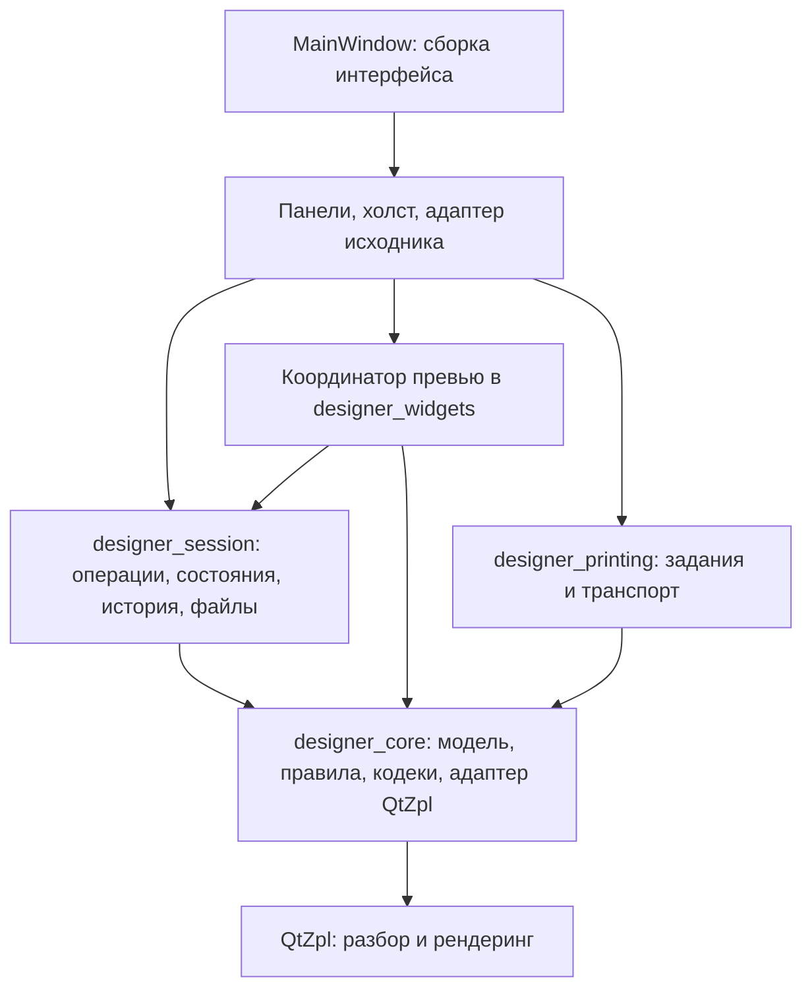

# Проект реорганизации QtZpl Designer для разработки с ИИ

Дата: 9 октября 2026 года. Статус: план будущих работ; реализация этапов не начата в рамках подготовки документа.

Связанный документ: [рекомендации для QtZpl](QTZPL_RECOMMENDATIONS.md).
Правила выполнения работ: [AGENTS.md](../AGENTS.md). Текущее поведение приложения: [README.md](../README.md).

Пути в примерах и команды указаны относительно корня соответствующего репозитория.

## 1. Цель и границы проекта

Снизить объём кода и скрытых связей, которые необходимо понимать для безопасного изменения одной возможности редактора. Сделать задачи достаточно самостоятельными, чтобы человек и несколько ИИ-агентов могли работать параллельно, а результат проверялся через явные контракты и воспроизводимые сценарии.

Сохраняем C++, Qt Widgets, библиотеку QtZpl и существующее разделение CMake-целей. Переходим постепенно: после каждого этапа приложение должно оставаться работоспособным. Изменения пользовательского поведения оформляются отдельными задачами, чтобы их можно было отличить от ошибок переноса.

Основной объём проекта — операции редактирования, состояния исходника, получение превью и разделение UI. Типизация содержимого элементов — отдельный поздний этап с повышенным риском совместимости. Перенос файлов по каталогам выполняется после выделения обязанностей.

В этот проект не входят смена UI-технологии, новый рендерер, редизайн, новый принтерный протокол, система плагинов или замена snapshot undo. Фоновый рендеринг рассматривается отдельно после измерений и проверки гарантий библиотеки.

## 2. Исходная архитектура и причины изменений

Наблюдения относятся к исходникам, просмотренным 9 октября 2026 года. Перед началом реализации нужно повторно проверить текущий код; номера строк и результаты старых сборок не являются исходной точкой проверки.

| Область | Текущее устройство | Задача реорганизации |
|---|---|---|
| Слои | `designer_widgets` → `designer_session` → `designer_core`; отдельный `designer_printing` | Сохранить направление зависимостей |
| Главное окно | `main_window.*` собирает UI, применяет свойства, согласует исходник, выделение и превью | Оставить сборку компонентов и действия уровня окна |
| Изменения | Часть операций находится в `DocumentSession`, часть копирует и меняет модель в окне | Один прикладной путь изменения документа |
| Исходник | `pendingSource_` в сессии и `codePending_` в окне участвуют в согласовании состояния | Один владелец состояния и явные переходы |
| Превью | Таймеры и результаты хранятся в окне; адаптер вычисляет изображение и геометрию | Отдельное управление запросами и результатами |
| Элементы | Общий `Element` содержит поля всех разновидностей | Постепенно выделить типизированные данные |
| История и файлы | Сессия уже владеет undo, сохранением и восстановлением | Сохранить владение, выделить внутренние помощники при необходимости |
| Проверки | Есть отдельные тесты ядра, сессии, холста, окна и возможностей | Использовать существующие сценарии; новые контракты проверять без всего окна |

Точки входа в код: [модель](../src/design_document.hpp), [сессия](../src/document_session.hpp), [окно](../src/main_window.hpp), [холст](../src/label_canvas.hpp), [адаптер превью](../src/preview_renderer.cpp), [ZPL-кодек](../src/zpl_codec.cpp), [карта исходника](../src/zpl_source_map.hpp), [формат проекта](../src/project_codec.hpp), [цели сборки](../CMakeLists.txt).

## 3. Неизменяемые требования

- Qt 6.11 или новее. Современный C++ согласно AGENTS.md и текущему CMake: MSVC `/std:c++latest` с метаданными CXX23; для остальных компиляторов — установленная проектом версия стандарта.
- Каждое превью строится через актуальные исходники соседней `../qt-zpl`. Модель библиотеки остаётся доступной редактору только для чтения.
- Координаты и размеры документа — printer dots. Zoom, тема, экранный DPI и расположение панелей не изменяют экспортируемую геометрию.
- Неподдерживаемый и неоднозначный ZPL, неизвестные команды и несколько этикеток сохраняются. Source mode остаётся полноценным способом работы.
- Исходные токены, комментарии, порядок и настройки ZPL сохраняются в уже поддерживаемых сценариях. Перенос не должен превращаться в нормализацию всех импортированных файлов.
- `.qtzpl` сохраняет применённый документ и неприменённый текст отдельно. Значения плейсхолдеров остаются данными текущей сессии.
- Ошибочная операция не оставляет частично изменённый документ. Неудачное открытие или сохранение не портит текущий документ, путь и признак изменения.
- Один законченный жест соответствует одной операции отмены. Отдельная текстовая история редактора ZPL и маршрутизация Ctrl+Z по фокусу сохраняются.
- Видимость на холсте и участие в печати остаются разными свойствами. Декорации редактора не попадают в PNG и печать.
- Оформление использует QPalette, постоянный QProxyStyle, QPainter и делегаты, без QSS. Переключение темы сохраняет геометрию, шрифты, курсор и состояние редакторов.
- Производственные INI не копируются в fixtures. Растровая приёмка опирается на принятые Labelary-эталоны, а не на изображения go-zpl.

## 4. Целевая архитектура

### 4.1. Границы модулей



Это направление зависимостей, а не порядок всех вызовов. Представления получают изменения через сигналы и читаемые снимки. Новая CMake-библиотека для каждого класса не требуется.

| Компонент | Ответственность | Что ему не принадлежит |
|---|---|---|
| `MainWindow` | Сборка компонентов, меню, размещение панелей, диалоги верхнего уровня | Правила штрихкодов, изменение полей модели, разбор ZPL, очередь рендера |
| `DocumentSession` | Единственный владелец применённого документа, истории, черновика исходника и жизненного цикла файла | Виджеты, курсор текста, геометрия окна |
| Операции редактора | Типизированные запросы, правила изменения, атомарное применение через сессию | Чтение значений из виджетов |
| Состояние исходника | Связь применённого документа, черновика и результата последнего применения | Текстовая история `QTextDocument` и его прокрутка |
| Координатор превью | Debounce, снимок запроса, актуальность результата, выбор страницы и режима | Собственный рендерер, изменение документа |
| Панель свойств | Показ значений, mixed state, преобразование пользовательского ввода в запрос | Нормализация типа штрихкода и управление undo |
| Модель выделения | Стабильные ID выбранных объектов и уведомления | Изменение документа при обычном выборе |
| Адаптер редактора ZPL | Курсор, текстовая история, подсветка и связь с состоянием сессии | Решение о допустимости экспорта и сохранения |

Названия будущих классов и файлов уточняются на соответствующем этапе. Контракты и владельцы состояния важнее названий.

### 4.2. Единый путь редактирования

Пользовательское действие → типизированный запрос → проверка применимости → расчёт нового документа → одна запись истории → уведомление наблюдателей.

Примеры запросов: `ChangeBarcodeType`, `UpdateText`, `UpdateElementProperties`, `ResizeElement`, `MoveElements`, `ApplySource`. Достаточно обычных методов и структур данных; универсальная шина команд и строковые имена свойств не нужны.

Чистые преобразования значений могут находиться в `designer_core`; правила сессии и запись в QUndoStack остаются в `designer_session`. Операция получает ID объекта и входные значения. Для размера текста или штрихкода дополнительно передаётся геометрия с проверяемой ревизией.

Проверка различает недопустимую операцию и допустимый промежуточный документ, который пока нельзя напечатать. Например, некорректные данные редактируемого GS1 не должны исчезать из макета только потому, что экспорт временно невозможен.

Отказ и операция без изменений не добавляют запись undo. Snapshot undo сохраняется. Общий `commit` с произвольной копией документа постепенно становится внутренним механизмом; миграция не должна оставлять второй постоянный путь записи из виджетов.

### 4.3. Состояние ZPL

Не пытаться выразить всё одним флагом. Разделить независимые признаки:

- применённый документ: визуально редактируемый или source-only;
- черновик: отсутствует, ожидает применения или отклонён при последней попытке;
- доступность экспорта: разрешён либо есть конкретная причина отказа;
- превью: отдельный производный результат, не источник истины для документа.

| Событие | Изменение состояния | Сохраняемое поведение |
|---|---|---|
| Ввод ZPL | Меняется черновик и его ревизия | Последний применённый документ остаётся доступен |
| Успешное применение | Документ заменяется атомарно; соответствующий черновик считается применённым | Один шаг истории; курсор и текстовая история не сбрасываются |
| Ошибка применения | Черновик остаётся с диагностикой | Документ не заменяется частичным результатом |
| Неподдерживаемый, но сохраняемый ZPL | Применяется документ source-only | Исходник и все этикетки сохраняются |
| Визуальная правка | Меняется документ; обновляется производный ZPL | Обновление текста не создаёт цикл сигналов |
| Сохранение `.qtzpl` | Записывается документ и имеющийся черновик | После успешного сохранения восстанавливается корректный clean-state |
| Undo/redo | Восстанавливается соответствующий применённый снимок | Значения подстановки текущей сессии не откатываются |

Смена документа и очистка черновика должны наблюдаться как согласованное изменение. Отложенный callback не может применить текст к уже открытому другому файлу. Сохранение ZPL, экспорт и печать проверяют наличие неприменённого текста; нельзя незаметно отправить старый макет вместо видимого пользователю изменения.

### 4.4. Превью и выделение

Каждый запрос содержит идентификатор экземпляра документа, ревизию применённого состояния, ревизию значений подстановки, DPI, страницу и режим «холст/печать». Изображение, bounds и диагностика относятся к одному снимку. После reset/open нельзя принять результат предыдущего документа даже при совпавшем счётчике ревизии.

На первом этапе рендер остаётся синхронным. Контракт актуальности нужен уже для таймеров; переход в фон не является условием завершения реорганизации.

Между компонентами выделение передаётся через существующие UUID элементов. Индексы остаются локальными для конкретного списка/снимка и переводятся в ID на границе адаптера. Жест мыши не должен использовать bounds от другого порядка элементов.

Карта исходника привязана к точной строке и ревизии редактора. Единицы смещений — UTF-16 позиции QString/QTextDocument после принятой нормализации переводов строк, а не байты UTF-8. Пока карта не соответствует тексту, переход от курсора к объекту не выполняется.

## 5. Этапы реализации

Каждый этап — отдельный законченный набор изменений. Подэтапы допустимы, если каждый сохраняет работоспособный сценарий. Чекбокс отмечается после проверки результата, а не после создания файлов.

### R0. Зафиксировать исходное поведение

- [ ] Перечитать актуальные AGENTS.md, README и публичные заголовки обеих библиотек.
- [ ] Зафиксировать версии/ревизии и локальные изменения обоих checkout перед проверкой; не откатывать чужую работу.
- [ ] Выполнить исходную проверку текущего Designer с текущей `../qt-zpl`; записать реальные исходные падения отдельно от будущих регрессий.
- [ ] Составить соответствие существующих тестов критическим сценариям из раздела 6.
- [ ] Добавлять characterization tests только для непокрытого поведения, которое будет затронуто ближайшим этапом.

**Готово, когда:** известна воспроизводимая исходная точка; старые записи README не выдаются за свежий результат. Ошибки зависимости обозначены явно и не обходятся старым snapshot.

### R1. Вынести операции изменения документа

- [ ] Начать со смены типа штрихкода, редактирования текста/свойств и изменения размера.
- [ ] Перенести правила GS1, MaxiCode, блокировки и допустимости операций из обработчиков окна.
- [ ] Использовать существующие операции групп, перемещения, вставки и удаления как часть того же прикладного API.
- [ ] Сохранить атомарность, source metadata и действующую snapshot-историю.
- [ ] Проверить операции на уровне ядра/сессии; оставить небольшую проверку подключения UI.

**Готово, когда:** перечисленные операции выполняются без MainWindow; соответствующие обработчики собирают запрос и показывают результат. Нет дублирующих правил в окне и сессии.

### R2. Сосредоточить переходы исходника в сессии

- [ ] Описать состояния и переходы из раздела 4.3 в одном контракте.
- [ ] Перенести применение ZPL и решение о допустимости визуальных правок из MainWindow.
- [ ] Связать pending source, dirty/clean-state, `.qtzpl`, recovery, сохранение и экспорт.
- [ ] Оставить курсор, прокрутку и QTextDocument undo в адаптере текстового редактора.
- [ ] Удалить независимый изменяемый дубликат `codePending_`; UI читает состояние сессии.

**Готово, когда:** переходы проверяются без главного окна; некорректный исходник переживает сохранение и восстановление; позднее применение не затрагивает новый документ.

### R3. Выделить управление превью

- [ ] Вынести таймеры, выбранную страницу, режимы и результаты из MainWindow в координатор.
- [ ] Ввести снимок запроса и проверку его актуальности.
- [ ] Сохранить различия editor preview и печатного превью, fallback-геометрию ошибочных объектов и поддержку нескольких этикеток.
- [ ] Не запускать рендер из-за темы, zoom, выделения или перемещения панелей.
- [ ] Описать границу адаптера QtZpl; использовать текущий API, пока расширения из отдельного документа не реализованы.

**Готово, когда:** изображение и геометрия согласованы; устаревший результат игнорируется; окно не управляет рендерингом. Изменение потоковой модели в этот этап не включается.

### R4. Разделить панели и выбор объектов

- [ ] Выделить панель свойств, слои, диагностику и адаптер редактора ZPL по их собственным контрактам.
- [ ] Ввести общее представление выделения по UUID и адаптеры индексов для холста/списка/превью.
- [ ] Сохранить смешанные свойства, группы, порядок слоёв, горячие клавиши и режимы расположения редакторов.
- [ ] Оставить MainWindow сборкой UI и координацией действий уровня окна.

**Готово, когда:** обычная правка одной панели не требует изменения остальных; выбор объекта после reorder/delete/undo не перескакивает на другой ID. Число строк окна само по себе не служит критерием качества.

### R5. Упорядочить внутренние обязанности сессии

- [ ] При необходимости выделить внутри `designer_session` помощники файловых операций, recovery и локальных настроек холста.
- [ ] Сохранить одного владельца документа, пути, dirty-state и истории.
- [ ] Оставить кодирование `.qtzpl`, значений и изображений в `designer_core`; ввод/вывод и жизненный цикл — в сессии.

**Готово, когда:** файловые ошибки проверяются без окна, а выделение помощников не создаёт нескольких конкурирующих владельцев состояния. Этап можно ограничить документацией границ, если дальнейшее дробление не упрощает код.

### R6. Типизировать содержимое элементов

- [ ] Выделить общие свойства: UUID, группа, имя, положение, блокировка, видимость, участие в печати и данные сохранения исходника.
- [ ] Спроектировать отдельные структуры содержимого текста, изображения, таблицы, фигур и разновидностей штрихкодов; использовать `std::variant` либо столь же явную композицию.
- [ ] Сохранить чтение прежнего формата `.qtzpl` и clipboard через адаптеры, не сериализовать числовой индекс variant как постоянный формат.
- [ ] Явно решить судьбу неактивных параметров при смене типа: плоская модель сейчас может сохранять параметры прежнего штрихкода. Не терять их молча.
- [ ] Переносить один класс элементов за раз, синхронно обновляя операции, валидацию, кодеки и тесты совместимости.
- [ ] Удалять временные адаптеры после завершения миграции; не поддерживать две независимые модели постоянно.

**Готово, когда:** все существующие типы и старые проекты поддержаны; source metadata, изображения, таблицы, группы и clipboard проходят round trip; не относящиеся к типу свойства не могут случайно попасть в его обработчик.

### R7. Упорядочить каталоги и завершить переход

- [ ] После стабилизации компонентов разнести файлы по ответственности: `src/core/`, `src/session/`, `src/widgets/`, `src/printing/`; обновить CMake и include-пути отдельным изменением.
- [ ] Сохранить тестовые цели по контрактам; крупные тесты делить по сценариям, а не произвольному числу строк.
- [ ] Добавить короткую карту «задача → компонент → проверки» и актуализировать README/AGENTS при изменении фактических границ.
- [ ] Удалить прежние обработчики, обходные пути записи и временные прослойки.
- [ ] Выполнить общую проверку и проверить ключевые пользовательские сценарии в нативном Windows backend.

**Готово, когда:** новая структура используется всеми существующими сценариями, а документация описывает фактическое состояние.

## 6. Проверка совместимости

| Контракт | Сценарии приёмки | Существующая отправная точка |
|---|---|---|
| История | Жест/групповая операция — один undo; redo сохраняет ID, геометрию, группы и source metadata; ошибка/no-op не меняет историю | `test_session.cpp`, `test_canvas.cpp` |
| Исходник | Валидный, ошибочный и source-only ZPL; переключение режимов; курсор, прокрутка и текстовый undo | `test_split_editor.cpp`, `test_source_tools.cpp` |
| Карта исходника | Кириллица, суррогатные пары, CRLF, несколько полей в строке, таблицы, смена ревизии | `test_source_map.cpp` |
| Сохранение | Старые `.qtzpl`, отдельный pending source, recovery, clean-state, ошибка записи и открытия | `test_projects.cpp`, `test_session.cpp` |
| ZPL без потерь | Неизвестные команды, несколько этикеток, комментарии и настройки вокруг изменённого поля, escaping, байты изображений | `test_document.cpp`, `test_extended_zpl.cpp`, `test_milk_import.cpp` |
| Превью | Тот же snapshot для растра/bounds; устаревшие результаты; ошибки отдельных кодов; страницы; editorVisible/printable | `test_preview.cpp`, `test_canvas.cpp`, `test_designer_extensions.cpp` |
| Геометрия | Повороты, baseline, обрезка, подписи кодов, отрицательные координаты; dots при разных zoom/DPI экрана | `test_canvas_transforms.cpp`, `test_extended_zpl.cpp` |
| UI | Тема, размеры окна, панели, mixed properties, горячие клавиши, фокус и выделение | `test_window.cpp`, `test_workspace.cpp`, `test_command_panels.cpp` |
| Печать | Неизменность отправляемых данных и размеров; шаблон/заполненная копия; ограничения нескольких этикеток | `test_printing.cpp`, `test_printer_profiles.cpp` |

Названия файлов обозначают область поиска, а не утверждение о полном покрытии. Сначала читать имеющиеся сценарии, затем добавлять только отсутствующие проверки контрактов. Не проверять внутреннюю последовательность приватных вызовов вместо результата.

Связанные изменения выполняются пакетом, затем запускаются относящиеся к ним проверки. Не делать сборку на каждую мелкую правку. Финальная проверка законченного этапа с изменением кода на Windows:

```text
py -3 tools/build_helper.py all --clean --config Debug
```

Новая проверка нужна при новых изменениях, падении или конкретном неразрешённом сомнении. Все временные материалы — в `build_agent/`, журналы — в `build_agent/logs/`. Каталоги Qt Creator не используются. В подготовке этого Markdown-плана сборки и тесты не запускались.

## 7. Организация работы с ИИ-агентами

Одна задача должна завершать конкретный сценарий через ограниченный набор компонентов. Агент получает входной контракт, разрешённые файлы, сохраняемое поведение и критерий приёмки. Не вводить жёсткий лимит строк или файлов: важнее связность изменения.

Перед параллельной работой один интегратор фиксирует общие контракты и владеет изменениями `DocumentSession`, модели, CMake и подключением компонентов. После этого можно независимо выделять панели, писать проверки операций и улучшать адаптер превью. Одновременная миграция одного общего заголовка несколькими агентами не планируется.

| Пакет | Зависимости | Возможное разделение |
|---|---|---|
| R0 | Нет | Инвентаризация контрактов и тестов параллельно; одна общая исходная сборка |
| R1 | R0 | Разные операции после согласования типов запросов; один владелец session API |
| R2 | R1 | Состояния и интеграция выполняются согласованно; тестовые сценарии можно готовить отдельно |
| R3 и части R4 | Стабильные контракты R1/R2 | Координатор превью и независимые панели в разных файлах |
| R5 | R2 | Файловые помощники независимо от панелей при неизменном session API |
| R6 | Стабильные R1–R5 | Один владелец модели и сериализации; самостоятельное ревью совместимости |
| R7 | Завершённые переносы | Перемещение путей и интеграция последовательно |

Шаблон будущей задачи:

```text
Этап и результат: R1 — смена типа штрихкода через операцию сессии.
Прочитать: AGENTS.md, README.md, Plan/REFACTORING_PLAN.md, текущий код и тесты сценария.
Граница: операция и её подключение; формат проекта и рендерер не меняются.
Сохранить: данные, source metadata, правила GS1/MaxiCode, один undo.
Проверить: применимость, no-op, запрещённое изменение, undo/redo, UI-подключение.
Завершить: краткий отчёт об изменении, проверках и оставшихся ограничениях.
```

После этапа обновлять его чекбоксы и журнал ниже. Найденные решения ошибок инструментов записывать в пользовательский WORKFLOW-NOTES.md; проектные архитектурные решения — в этом документе либо отдельной короткой записи в репозитории.

## 8. Связь с развитием QtZpl и критерий завершения

R0–R5 можно выполнять с текущим API QtZpl. Расширения библиотеки для рендера одной страницы, получения геометрии полей и информации о разобранном исходнике уменьшают сложность адаптера, но не должны блокировать выделение компонентов.

Каждое принятое расширение реализуется отдельной задачей в `qt-zpl`, со своими проверками и последующим обновлением адаптера Designer. Исходники зависимости не меняются попутно ради прохождения сборки и не заменяются прежним checkout.

Проект завершён, когда правила редактирования и состояния исходника проверяются без MainWindow; виджеты не меняют модель напрямую; превью относится к определённому снимку; компоненты можно изменять независимо; прежние документы и пользовательские сценарии сохраняются. Полное выполнение поздней типизации R6 учитывается отдельно, если этот этап отложен.

## Журнал выполнения

| Дата | Этап | Результат | Проверки и ограничения |
|---|---|---|---|
| 2026-10-09 | Подготовка | Создан проект реорганизации по текущим исходникам | Статический просмотр; код не менялся, сборки не запускались |
